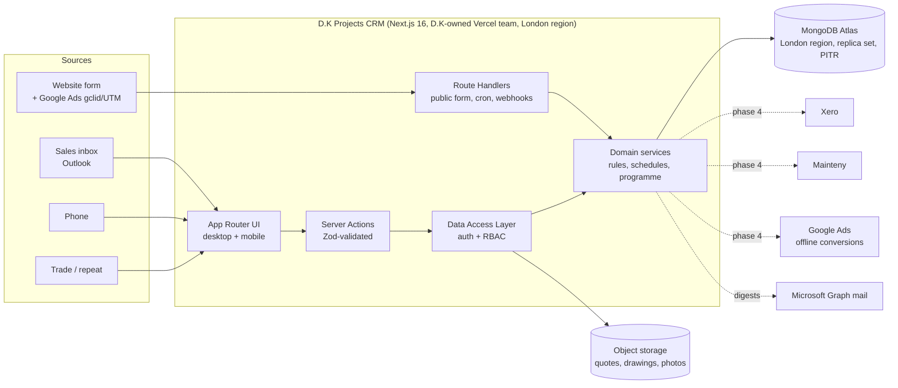

# D.K Projects CRM — Engineering Plan

Source: *D.K Lift Services — Projects CRM, Proposal for Discussion* (October 2026) and the working session of 7 October 2026.
Status: draft for the Phase 0 design session. Field lists and stage names below are proposals; the client confirms them.

> **Revision (27 Oct 2026):** the stack moved to **MongoDB Atlas + shadcn/ui on Vercel**, at the client's request. Modules 01–05 and the website intake are implemented in this repository; see the README for how it is built and deployed. Sections below are updated where the choice changed.

> The PDF we received has 18 pages. The contents page also lists *Commercials and delivery* (p.19) and a *Technology landscape* appendix (p.23), but those pages are missing. The phasing in §9 is our engineering view. Reconcile it with the commercial pages before it goes to the client.

---

## 1. What we are building and why

D.K Lift Services is a 10-person lift specialist in Dartford. It sells 14–15 products (platform, step, home and service lifts, and stairlifts) to three segments: domestic, end users and main contractors, and other lift companies. Right now about 3 live projects a month run through a spreadsheet, the sales inbox and Xero. The target is 12.

The proposal names four constraints. Each module exists to fix one, and each fix can be measured:

| Constraint | Today | Module | Success metric (measured in the CRM) |
|---|---|---|---|
| Enquiry visibility | ~45% of enquiries never reach the Monday review | 01 Opportunities & clients, 02 Pipeline | 100% of enquiries logged, each with an owner and a dated next action |
| Quote follow-up | ~8 hrs/month of MD time; day-4/day-10 touches get missed | 03 Quotes & follow-up | Follow-up tasks auto-created for 100% of sent quotes; ≥90% completed on the due day |
| Project coordination | ~40 hrs/month of PM time; 3–4 hrs to build each programme | 04 Live projects | Programme generated from a template in under 15 minutes |
| Cash collection | 3 invoices per project, each raised and chased by hand | 05 Billing milestones | Every 60/20/20 milestone has a due date; 0 milestones overdue without a chase task |

**Explicitly out of scope** (per the proposal):
- Maintenance and repairs stay in **Mainteny**.
- Accounting stays in **Xero**.
- Email stays in **Outlook/Fyxer**.
- Quotes are still written by the MD in D.K's existing 7-page format. The CRM **attaches** quotes; it does not generate them.

**Constraints that drive the design:**
- About 12 users and tiny data volumes: tens of opportunities and projects a month, and a few thousand rows a year.
- Hosted in **D.K's own account**, so the client owns the infrastructure and the data.
- One responsive web app that works on desktop and on a phone. There is no native app. The MD is on site most of the week.
- A new enquiry must be loggable in under 2 minutes on a single screen.

---

## 2. Architecture



### Stack decisions

| Concern | Choice | Rationale |
|---|---|---|
| App framework | **Next.js 16** (already scaffolded: App Router, `cacheComponents`, Tailwind 4) | One codebase for UI and API. Server Components keep the data on the server. Responsive UI covers the mobile need. |
| Database | **MongoDB Atlas** (London region, replica set) | Records map naturally onto documents: a client with its contacts, sites and lifts; an opportunity with its survey and quote revisions; a project with its programme and 60/20/20 milestones. Transactions cover the few multi-document writes. Atlas scales storage and reads without re-platforming, and has continuous backup. |
| Data access | **Official MongoDB driver** + typed collections, Zod at the edges, idempotent index setup (`npm run db:setup`) | No ORM layer to fight. Aggregation pipelines drive the dashboard and Monday review. |
| Auth | **Better Auth** (MongoDB adapter) with email/password and optional **Microsoft Entra ID** sign-in (D.K already uses M365) | Admin-created accounts only. Microsoft SSO brings MFA and leaver offboarding from M365. |
| UI | **shadcn/ui** (Radix + Tailwind 4), D.K black/red theme | Accessible primitives owned in the repo; the same components serve desktop and phone. |
| Validation | **Zod** schemas shared by forms and Server Actions | One definition of "required field". |
| Files | Private **Vercel Blob** store; uploads go straight from the browser using short-lived client tokens; downloads go through an authenticated route | Quotes, drawings (with revisions), survey photos and RAMS. |
| Scheduled jobs | Vercel Cron calling Route Handlers | Daily digest, Monday review pack, overdue sweeps. Volumes are tiny, so no queue is needed. |
| Outbound email | Microsoft Graph `sendMail` from a D.K mailbox | Mail comes from D.K's own domain, with no extra vendor. |
| Testing | Vitest (domain rules), Playwright (critical flows) | Playwright is already available in the dev environment. |
| Observability | Vercel logs + Sentry | Enough for 12 users. |

### Next.js 16 conventions to follow

These are from `node_modules/next/dist/docs`, as `AGENTS.md` requires.

- **`proxy.ts`, not `middleware.ts`.** The `middleware` convention is deprecated and renamed. Use it only for an *optimistic* redirect to `/login` when there is no session cookie.
- **Authorisation lives in the DAL.** Every Server Action and data read goes through `lib/dal`. The DAL calls `verifySession()` and checks the role. Never rely on `proxy.ts` or hidden UI for security.
- **Cache Components is on.** A session read happens at request time, so the authenticated UI streams behind `<Suspense>`. Use the pattern in `02-guides/authentication-with-cache-components.md`.
  - Reference data (products, users, stage probabilities) goes in `'use cache'` with `cacheTag`.
  - Mutations call **`updateTag`** inside Server Actions so the user reads their own writes immediately. `updateTag` is only valid in Server Actions; use `revalidateTag` in Route Handlers, such as the website-form endpoint and webhooks.
  - Operational CRM data (pipeline, tasks) stays dynamic. It changes constantly and is cheap to query.
- **Side effects** that must not block the response (sending email, writing to an integration outbox) go in `after()`.

### Code layout

```
app/
  (auth)/login/
  (app)/                      # authenticated shell: sidebar on desktop, bottom tabs on mobile
    today/                    # mobile home: my tasks, site visits this week
    dashboard/
    pipeline/                 # board | list | monday-review | won-lost
    enquiries/ surveys/ quotes/ follow-ups/
    projects/ [ref]/programme/
    billing/
    clients/ [slug]/
    settings/ products/ users/ stage-probabilities/
  api/
    enquiries/route.ts        # public website form (Turnstile + rate limit)
    cron/[job]/route.ts       # CRON_SECRET-protected
lib/
  db/ mongo.ts collections.ts types.ts
  dal/                        # session, RBAC, queries; the only module that touches db
  domain/                     # pure, unit-tested: stages, followUpRules, billingSchedule,
                              # programmeTemplate, metrics
  actions/                    # 'use server' — thin: parse → dal → domain → updateTag
  integrations/ graph/ xero/ googleAds/
components/ ui/ pipeline/ programme/ ...
proxy.ts
```

**Principle:** the business rules (60/20/20, day 4/10/14, programme durations) live in `lib/domain` as pure functions that take a clock. Rules are tested without a database and stay in one place when D.K changes them.

---

## 3. Domain model

Conventions:
- Money is stored as **integer pence**.
- Every row has `created_at`, `updated_at`, `created_by` and a soft-delete column.
- Human references are generated from per-type sequences: `ENQ-2631`, `Q-1187`, `P-0412`.

| Entity | Key fields | Notes |
|---|---|---|
| **User** | name, email (Entra), role, active | Roles: `md`, `sales_admin`, `project_manager`, `accounts`, `maintenance_manager`, `engineer`, `admin` |
| **Client** | name, slug, segment (`domestic` / `end_user_contractor` / `lift_company`), client type (housing association, school, care home…), account_owner_id, notes | A domestic client is a person, so the client and contact are effectively 1:1 |
| **Contact** | client_id, name, role (decision maker, procurement, site caretaker…), email, phone | Held by role, as on the client page |
| **Site** | client_id, name, address, postcode, access notes | Multi-site trade clients |
| **Lift** (installed asset) | site_id, product_id, installed_by_project_id?, serviced_by (`dk` / `other`), on_maintenance, mainteny_ref, handover_date, warranty_end | Drives "5 lifts on site, 2 on maintenance". Lifts serviced by others are also sales signals |
| **Product** | name, category, manufacturer, default_lead_time_weeks, default_install_days, active | The 14–15 products, editable in Settings |
| **Opportunity** (`ENQ-`) | client_id, contact_id, site_id, product_id, quantity, segment (snapshot), source (`google_ads`, `website`, `email`, `phone`, `trade`, `repeat_referral`), campaign, gclid, utm_*, value_low/value_high, owner_id, stage, decision_date, install_window, lost_reason, lost_to, won_at, project_id | Required on create: client, contact, segment, product, source, owner, next action |
| **Survey** | opportunity_id, scheduled_at, attendees, surveyor_id, measurements, builders/civil-works notes, photos, fee_pence (default £350 for `lift_company`), fee_status (`none` / `invoiced` / `paid` / `credited`) | The fee is shown as a credit when the project is won |
| **Quote** (`Q-`) | opportunity_id, revision, total_pence, options[] (label, pence, included?), document_id, status (`draft` / `sent` / `superseded` / `accepted` / `declined`), sent_at | Revision history is kept. Only one quote per opportunity can be "current" |
| **Task** | subject (opportunity / project / milestone), kind (`call` / `email` / `survey` / `doc` / `chase` / `general`), title, owner_id, due_on, completed_at, outcome, rule_key (e.g. `quote.followup.d4`) | Used for every follow-up and "next action" |
| **Activity** | subject, type, actor, occurred_at, payload (jsonb) | Append-only event log. Feeds the activity panels and every time-based metric |
| **Project** (`P-`) | opportunity_id, client_id, site_id, pm_id, contract_value_pence, client_po_ref/date, manufacturer, manufacturer_po_ref, status (`awaiting_po` / `live` / `complete` / `warranty` / `cancelled`), current_stage | Created when an opportunity is won |
| **ProgrammeItem** | project_id, kind, planned_start/end, actual_start/end, is_milestone, depends_on, notes | Generated from a template; see §5 |
| **BillingMilestone** | project_id, kind (`deposit_60` / `mid_20` / `final_20`), percent, amount_pence, trigger, due_on, status (`scheduled` / `due` / `raised` / `paid` / `overdue`), xero_invoice_ref, raised_at, paid_at | Accounts set the status (phase 1) |
| **Document** | subject, category (quote, drawing, photo, RAMS, contract…), revision, blob_key, uploaded_by | Drawings keep their revisions ("Rev B") |
| **AuditLog** | actor, entity, entity_id, diff, at | Every mutation. Also covers GDPR access requests |

Opportunity stage lifecycle:

```
enquiry → survey_booked → quote_sent → follow_up → won | lost
    └───────────────────────────────────────────────┘ (any open stage can be lost, with a reason)
```

- Stage changes go through a single `transitionStage()` domain function. It validates the move, writes an `Activity` row and runs the stage rules.
- Domestic enquiries that skip the survey may go `enquiry → quote_sent`.
- Weighted pipeline uses per-stage probabilities stored in settings. The mockups suggest 10% / 25% / 40% / 50%.
- Pipeline value is the quote total once a quote exists. Before that, it is the midpoint of the estimated range.

---

## 4. Modules: scope and acceptance criteria

### 01 Opportunities and clients
- A **single new-opportunity form** for every source, on one screen on mobile.
  - Choose a client or create one inline. The contact and site are scoped to the chosen client.
  - Segment toggle, product, source, value range, owner, and a next action with a due date.
- **Public website form**: `POST /api/enquiries`.
  - Captures the gclid and UTM parameters from a hidden field set on the site.
  - Protected by Cloudflare Turnstile and a rate limit.
  - Creates an unassigned `enquiry` that lands in the sales-admin triage queue with a same-day "log & assign" task. This closes the main path for the ~45% leak.
- **Client page**:
  - Lifetime value, open pipeline, win rate and lifts on site.
  - Opportunities and projects, sites, contacts, and the activity timeline with notes and documents.
  - Actions: log call, add site, new opportunity.
- Duplicate detection on create: normalised client name, email domain, and postcode.
- **Done when**: the sales admin logs a phone enquiry in under 2 minutes on a phone, and the spreadsheet is retired.

### 02 Pipeline and reporting
- **Board**:
  - Columns by stage, with card value, age and badge (New / Day 2 / Call today / PO in).
  - Drag a card to change its stage. The drag still goes through `transitionStage`.
  - Filters: owner, source, segment, B2B/B2C.
- **List view** with CSV export.
- **Monday review**: one screen replaces the round-up.
  - New enquiries this week.
  - Pipeline by stage.
  - Overdue follow-ups.
  - Quotes awaiting a decision, grouped by age (0–7, 8–14, >14 days).
  - Day-14 escalations.
  - Billing milestones due or overdue.
  - Projects with a milestone this week.
- **Sales dashboard** (This month / Quarter / YTD / Last 12 months):
  - Pipeline and weighted pipeline.
  - Win rate.
  - Won this month.
  - By stage and by source.
  - Top 5 open opportunities.
  - Won and lost value by month.
  - Average days from enquiry to decision.
- All metrics are SQL over `opportunity` + `activity`, implemented in `lib/domain/metrics`. No warehouse is needed.

### 03 Quotes and follow-up
- **Survey record**: booking, attendees, measurements, photos (upload from the phone camera), and the £350 trade fee with its credit-on-win.
- **Quote register**: upload the PDF, enter the total and options, and track revisions.
- **Follow-up rule** (in `lib/domain/followUpRules`, idempotent). Marking a quote as **sent**:
  - creates a **day-4 email** task and a **day-10 call** task for the opportunity owner;
  - moves the opportunity to `quote_sent`, then to `follow_up` when the day-4 task falls due;
  - flags it on **day 14** for the Monday review if there is no response;
  - closes the open follow-up tasks automatically, with an activity entry, when the opportunity is won or lost or a new revision is sent (the new revision restarts the clock).
- **Follow-ups page**:
  - Tabs: My tasks / Team / Overdue / Completed. Overdue tasks always show first.
  - Follow-up discipline: tasks completed on their due day ÷ tasks due, over 30 days.
  - Open tasks by owner, and quotes awaiting a decision by age.
- **Won/lost** requires a reason from a configurable list and, optionally, the competitor.

### 04 Live projects
- **On win**, the system:
  - creates a `Project` from the opportunity;
  - carries over the survey and quote documents;
  - assigns the PM;
  - generates the programme and the billing schedule.
- **Work in progress**:
  - Stage tracker (PO → drawings → manufacture → delivery → install → handover).
  - Contract value and the % invoiced.
  - Next milestone, with a flag when it falls this week or next.
  - Install week and status.
- **Programme view** (Gantt, weekly columns):
  - Generated from a **template anchored on the client PO date** (§5).
  - The PM adjusts dates, and dependent items shift.
  - This is the 3–4 hrs → minutes win.
- **Drawings**: upload with revision, mark them rebadged, and record site sign-off. The two-step check becomes two checkboxes with an owner and a date.
- **Handover** records:
  - the warranty start;
  - the `Lift` asset against the site;
  - tasks for the maintenance manager: the 3- and 9-month warranty services and the service-plan offer.

### 05 Billing milestones
- Created with the project: **60% deposit** (due on the client PO), **20% mid** (due **1 month before manufacturer release**), **20% final** (due at **handover + 30 days**).
- Due dates are *derived from the programme*. When the release date moves, the mid-invoice due date moves with it.
- **Accounts** set Raised (with the Xero invoice number) and Paid. Overdue is computed. An overdue milestone auto-creates a chase task for accounts.
- **Release guard**: if manufacturer release is ≤ 14 days away and the 60% + 20% are not both paid, the project shows a red warning on WIP, Programme and the Monday review. This protects "the lift leaves the factory only once 80% is received".
- A Billing page shows the amount due in the next 30 days and the overdue milestones. Credit-control filters are available.

### Cross-cutting: mobile
- Bottom tabs: Today / Pipeline / Projects / Clients, plus a floating "+" button for a new opportunity.
- **Today** shows my tasks (overdue first), the pipeline headline and site visits this week.
- No offline mode in v1, because 5G coverage is assumed on site. Revisit if engineers need it on site.

---

## 5. Domain rules (to confirm in Phase 0)

| Rule | Proposed default | Question for D.K |
|---|---|---|
| Follow-up offsets | Day 4 email, day 10 call, day 14 escalation, all from `quote.sent_at` | Calendar days or working days? |
| Survey fee | £350 for `lift_company` only, credited on win | Ever charged to other segments? Is the credit applied against the deposit? |
| Billing split | 60/20/20, editable per project | Do any contracts use a different split (e.g. main-contractor retentions)? |
| Mid-invoice trigger | Release date − 1 month | Is "release" the manufacturer's ready date or the collection date? |
| Final invoice | Due handover + 30 days | Raised at handover, payable in 30 days? |
| Programme template | Client PO & 60% (wk 1) → manufacturer PO (wk 1–2) → drawings issued & rebadged (wk 2–3) → site sign-off (wk 3) → manufacture (10–12 wks, from the product default) → collection/customs/storage → labour & RAMS confirmed → install (5 days; product default) → handover → warranty services at 3 and 9 months | Should the template differ by product or manufacturer? |
| Stage probabilities | Enquiry 10%, Survey booked 25%, Quote sent 40%, Follow-up 50% | Do they want to tune these? |

---

## 6. Permissions

| Capability | MD | Sales admin | PM | Accounts | Maintenance mgr | Engineer |
|---|---|---|---|---|---|---|
| Create/edit opportunities, clients | ✓ | ✓ | ✓ | read | read | — |
| Change stage, mark won/lost | ✓ | ✓ (not won/lost) | ✓ | — | — | — |
| Quotes and surveys | ✓ | ✓ | ✓ | read | — | — |
| Projects and programme | ✓ | read | ✓ | read | read | read (assigned) |
| Billing status | ✓ | read | read | ✓ | — | — |
| Dashboard and Monday review | ✓ | ✓ | ✓ | ✓ | ✓ | — |
| Settings, users | ✓ | — | — | — | — | — |

The matrix is enforced in `lib/dal`. UI controls are hidden as a convenience, never as the control.

---

## 7. Integrations

| System | Phase 1–3 (v1) | Phase 4 (fast follow) |
|---|---|---|
| **Website / Google Ads** | Public enquiry endpoint captures gclid and UTM; the source report shows value by channel | Upload **offline conversions** (won value by gclid) to Google Ads so spend is optimised on revenue, not form fills |
| **Xero** | Accounts enter the invoice number and status by hand (as proposed) | OAuth app: create **draft invoices** from milestones, and pull paid status by webhook or polling. This removes double entry and the Mainteny→Xero lag that causes wrong chasers |
| **Outlook (sales inbox)** | Sales admin logs enquiries in the CRM | Graph integration: a "Log as opportunity" action on a shared-mailbox message that attaches the thread to the record; digests sent through Graph |
| **Mainteny** | At handover, a task tells the maintenance manager to create the lift in Mainteny; store `mainteny_ref` | API sync of the lift asset, if Mainteny exposes one (to verify) |
| **Fyxer, Apollo** | Unchanged | — |

Each integration sits behind an interface in `lib/integrations/*`. Outbound calls go through an `integration_outbox` table with retries, so a Xero outage never blocks a user action.

---

## 8. Data, security and operations

- **UK GDPR**: domestic clients are private individuals.
  - Data is hosted in the UK (London) region.
  - A record of processing is kept, and there is a retention policy (e.g. lost domestic enquiries anonymised after 3 years, to confirm).
  - Subject-access and erasure are supported through an export and an anonymise action.
- **Access**:
  - Entra SSO with MFA enforced in M365.
  - Sessions are revoked on leaver offboarding.
  - Least-privilege roles.
  - Audit log on every mutation.
- **Files**: private bucket, signed URLs (≤ 10 minutes), and a MIME and size allow-list.
- **Public endpoint**: Turnstile, rate limit, honeypot, and payload validation with Zod.
- **Backups**: managed Postgres PITR (≥ 7 days), plus a nightly logical dump to D.K-owned storage. The restore is tested once before go-live.
- **Environments**:
  - `preview` (per PR, seeded with illustrative data) and `production`.
  - Migrations run in CI before deploy.
- **CI**: typecheck, lint, Vitest, then a Playwright smoke test on the preview deploy for these flows:
  - log enquiry → book survey → send quote (tasks created) → win → project + programme + billing.
- **Cost**: well within hobby/pro tiers at this scale. Expect tens of pounds a month, all on D.K's own billing.

### Migration
1. **Clients, contacts, sites**: import from the Xero contacts export and the Mainteny sites/lifts export. Dedupe on normalised name and postcode, and have D.K review the result.
2. **Pipeline**: import the projects spreadsheet into opportunities, mapping its stages to ours. Rows with gaps land in a "needs review" queue owned by the sales admin.
3. **Live projects**: enter by hand with the PM (≈ 3–6 projects). Generate the programme from the template, then adjust it.
4. **Parallel run**: two Monday reviews from both systems. The spreadsheet then becomes read-only.

The importers are idempotent scripts (`scripts/import/*`) with dry-run output.

---

## 9. Delivery phasing (engineering view)

| Phase | Weeks | Scope | Exit criterion |
|---|---|---|---|
| **0 Design** | 1 | Phase 01 design session: confirm fields, stages, rules (§5), roles, products, migration sources. Click-through of the key screens | Signed-off field list and rules |
| **1 Foundations + Modules 01–02** | 2–5 | Auth/SSO, RBAC, schema, audit, clients/sites/contacts, opportunity form (desktop + mobile), website endpoint, board/list, dashboard, imports | Spreadsheet retired; Monday review run from the CRM |
| **2 Module 03** | 6–8 | Surveys, quote register, follow-up rules, Follow-ups page, Today (mobile), Monday review screen, daily digest email | Every sent quote has auto-tasks; discipline metric live |
| **3 Modules 04–05** | 9–12 | Projects on win, programme template + Gantt, drawings, handover/lifts, billing milestones, release guard | All live projects and their 60/20/20 schedules held in the CRM |
| **4 Integrations** | 13+ | Xero invoice sync, Google Ads offline conversions, Outlook "log as opportunity", Mainteny handoff | Agreed separately |

Each phase ships to production behind real logins and is used by the team before the next phase starts. Work is ordered by the constraint it removes, and enquiry visibility comes first because everything downstream depends on it.

### Client time needed
- **MD**: Phase 0 workshop, plus 30 minutes a week of acceptance.
- **Sales admin**: migration review, plus testing the form.
- **PM**: programme template and drawings flow (Phase 3).
- **Accounts**: billing flow (Phase 3) and Xero (Phase 4).

---

## 10. Risks

| Risk | Mitigation |
|---|---|
| Adoption: the MD is on site, so logging slips back to email | Mobile-first form and Today screen; Monday review runs *only* from the CRM after Phase 1; daily digest of their own overdue tasks |
| Data quality from the spreadsheet | Review queue, required fields, duplicate detection |
| Scope creep into quote generation or maintenance | Explicitly out of scope; attach, don't generate; Mainteny stays the maintenance system |
| Double entry with Xero until Phase 4 | Minimal fields (invoice number + status); prioritise the Xero sync if accounts' time doesn't drop |
| Rules differ by contract (retentions, other splits) | Billing schedule editable per project; template rules held in settings, not code constants |
| Single sales admin as a bottleneck | Website enquiries auto-create records; triage queue visible to the MD |

## 11. Open questions for the client
1. Calendar or working days for the follow-up rules?
2. What exactly is "manufacturer release" (the mid-invoice trigger)?
3. Is the D.K tenancy M365 (Entra ID)? Who administers it?
4. Which website platform hosts the enquiry form, and who can add the script and endpoint?
5. Are there contract variations to 60/20/20 (main-contractor retentions, CIS)?
6. Data retention for lost and domestic enquiries?
7. Does Mainteny have an API? Which Xero plan and user will authorise the app?
8. Are multi-lift opportunities (e.g. "platform lift ×2") quoted and billed as one project or several?
9. Should engineers have logins in v1, or only office roles?
10. The missing proposal pages (commercials, delivery, technology appendix): please share them so this plan can be reconciled against them.
